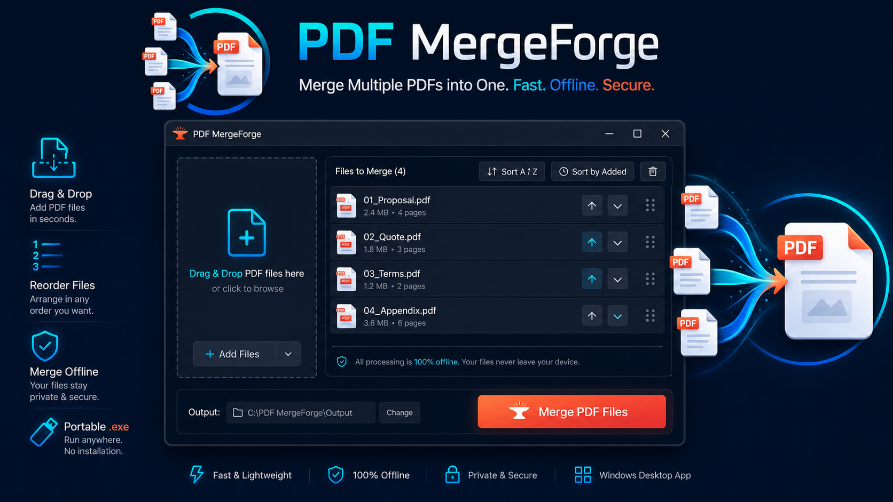
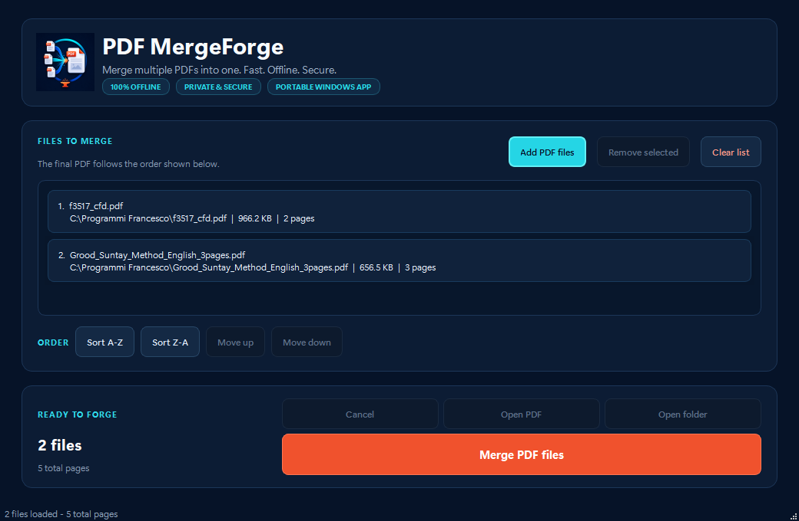
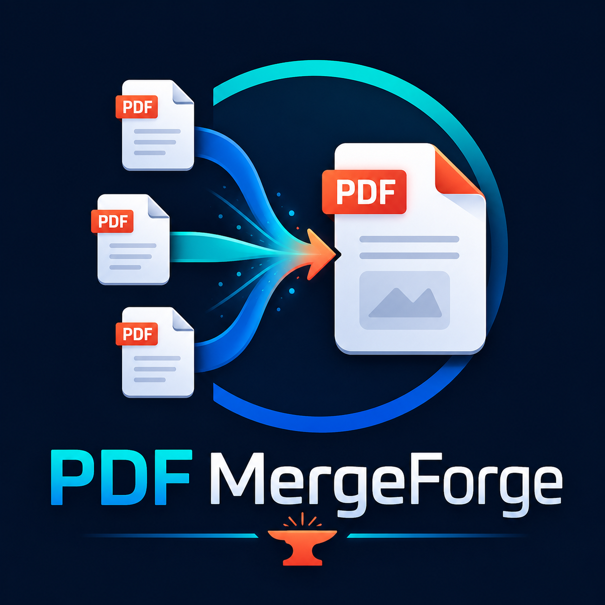

# PDF MergeForge



**Merge, organize, archive, and convert PDFs on your own computer - with no
uploads, subscriptions, provider fees, or loss of document privacy.**

PDF MergeForge is a portable Windows 10/11 x64 desktop application for ordering
and merging PDFs, exporting archival PDF/A-1b files, and converting PDFs into
editable Word documents. All document processing runs locally; no account, API,
cloud service, or Internet connection is required.





## Features

- Add multiple PDFs or drag them into the window.
- Brand-matched dark interface with high-contrast controls and clear empty, active,
  progress, success, error, and disabled states.
- Natural A-Z/Z-A sorting, multi-selection, internal drag reordering, Move up/down.
- PDF structure, page-count, encryption, existence, and duplicate validation.
- Responsive background merge, cooperative cancellation, atomic temporary-file output.
- Optional output-length limit that keeps only the first selected number of pages.
- Open the completed PDF or reveal it in Explorer.
- Export an archival PDF/A-1b using a separately installed 64-bit Ghostscript.
- Convert ordered PDFs to editable Word `.docx` files; recognize common bullet and numbered lists, read embedded font metadata, and preserve image proportions without flattening whole pages.
- Local-only settings and technical logs in `%LOCALAPPDATA%\PDF MergeForge\logs`.

## Convert PDF to Word

1. Add and order one or more PDFs.
2. Choose **Convert to Word** or press **Ctrl+W**.
3. Select a `.docx` destination.

**Preserve original layout** uses pypdf layout extraction to keep text positioning more closely aligned while keeping text editable. Common PDF bullet symbols and typed numbering are converted into native, editable Word lists. When the PDF embeds TrueType fonts, the converter reads their family, weight, and dominant point size and applies that style to the extracted page text. Embedded images retain their proportions and are placed after the page text. Conversion runs locally without Microsoft Word automation or Ghostscript. Font styling and complex columns or tables remain approximate, and scanned pages without a text layer are marked because OCR is not bundled.

## Limit the output length

1. Add and order the source PDFs normally.
2. Enable **Limit output length** below the page summary.
3. Enter the maximum number of pages for the final document.
4. Choose **Merge PDF files** or **Export as PDF/A-1b**.

The limit applies across the complete ordered merge. For example, a three-page limit
keeps pages 1-3 of the combined document even if page 3 comes from the second source
file. If the limit is greater than the total length, every page is kept. Source PDFs
are opened read-only and are never shortened or overwritten.

## Download

1. Open the latest GitHub Release.
2. Download the current `PDF-MergeForge-...-Windows-x64.exe` asset.
3. Double-click the downloaded file.
4. No installation is required.

**That single `.exe` is the only file an end user needs.** It already contains the
Python runtime, the GUI toolkit, the PDF engine, and the application assets. Do not
download the source-code ZIP unless you want to inspect or develop the project.

Windows SmartScreen may warn because the executable is not digitally signed. The one-file build can also take a few seconds to start. Windows 10/11 x64 only.

## PDF/A-1b export

The **Export as PDF/A-1b** button creates an archival PDF/A part 1, conformance level B.
This optional feature invokes a separately installed 64-bit Ghostscript command-line
executable (`gswin64c.exe`). Ghostscript is not included in PDF MergeForge or its EXE;
normal PDF merging continues to work without it.

Install Ghostscript from the [official Ghostscript download page](https://ghostscript.com/releases/gsdnld.html).
The app checks a saved manual location, `PATH`, and versioned folders below
`C:\Program Files\gs`. If automatic detection fails, choose **Locate gswin64c.exe** and
select the executable normally found below `C:\Program Files\gs\<version>\bin`.

Conversion, baseline checks, and optional veraPDF validation all run locally. Baseline
checks verify essential structural indicators but are not a complete standards validation.
Release 1.3.0 includes veraPDF 1.30.2 and an Eclipse Temurin JRE 17 as
separately licensed third-party components. They are extracted by PyInstaller to its
private runtime directory and used for an independent PDF/A-1b check. A manually
selected external veraPDF remains supported. Keep the original documents: conversion can flatten
transparency, alter unsupported features or rendering, and normally invalidates digital
signatures. PDF/A conformance does not guarantee acceptance by every authority.

No separate veraPDF or Java installation is required in release 1.3.0.
**External tools** shows the incorporated version and path. **Validate now** checks the most recently created
PDF without repeating conversion. **Passed** means independent validation succeeded,
**Not performed** means the optional validator was not detected, and **Failed** means
veraPDF reported non-conformance. Baseline checks are safeguards, not a substitute for
independent standards validation. PDF MergeForge source code remains MIT; veraPDF is
distributed under MPL 2.0+, and Eclipse Temurin under GPLv2 with the Classpath Exception.
Ghostscript remains external because its licensing and distribution model differ.

See [docs/PDF_A_1B.md](docs/PDF_A_1B.md) for setup, limitations, and troubleshooting.

## Development

```powershell
py -3.12 -m venv .venv
.\.venv\Scripts\python -m pip install -r requirements-dev.txt
.\.venv\Scripts\python run_app.py
.\.venv\Scripts\python -m pytest
.\.venv\Scripts\ruff check .
```

Build a diagnostic directory with `build_onedir.bat`, then the portable executable with `build_onefile.bat`. `build_release.ps1` runs quality checks, both builds, and prepares the release files.

## Repository layout

```text
assets/                          Application icon and project artwork
docs/                            PDF/A setup and troubleshooting
release/v1.3.0/                  Release notes, checksum, and local Windows EXE
scripts/                         Build, release, checksum, and validation helpers
src/pdf_merger_desktop/          Application source
  services/                      Ghostscript and PDF/A services
  utilities/                      Shared helpers
  widgets/                        Reusable interface widgets
  pdf_to_word_service.py          Editable PDF-to-DOCX conversion
  word_worker.py                  Background Word-conversion worker
tests/                            Application and conversion tests
pyproject.toml                    Package metadata and Python dependencies
build_release.ps1                 Release checks and packaging
```

The `.exe` in `release/v1.3.0/` is a local release asset and is excluded from Git by
`.gitignore`; attach it to a GitHub Release separately. The release folder keeps the
versioned notes and SHA-256 checksum alongside the local binary. Cancellation takes
effect between source PDFs and immediately before writing; a very large current PDF
page sequence may take time to finish.

## Why local PDF processing matters

Many online PDF services require users to upload contracts, forms, reports, personal
records, or other confidential documents to a third-party server. Some add usage
limits, subscriptions, provider fees, advertising, or account requirements.

PDF MergeForge takes a simpler approach:

- Your documents stay on your Windows computer.
- PDF merging and PDF-to-Word extraction run locally using the bundled `pypdf` library.
- No document is uploaded, transmitted, synchronized, or remotely analysed.
- There are no subscriptions, per-document charges, API fees, or usage limits.
- The application remains usable without an Internet connection.

See [PRIVACY.md](PRIVACY.md) for the exact local data flow and storage behaviour.

## Privacy, security, licensing, and responsibility

Source PDFs are opened read-only and are never uploaded or modified. Password-protected PDFs are rejected; the app does not bypass protection. The program has no automatic updater. Report bugs with the GitHub issue template, excluding sensitive PDFs and logs unless reviewed. MIT licensed.

The source code is licensed under the [MIT License](LICENSE), Copyright (c) 2026
Francesco, creator of PDF MergeForge. The official name, logo, icon, banner, and
artwork are separately protected under [BRAND_LICENSE.md](BRAND_LICENSE.md).

The software is provided **as-is, without warranty**. Use it at your own risk. Users
are responsible for backups, selecting the correct files and destination, verifying
the resulting PDF or Word document, and complying with applicable laws and document rights. The
legally controlling warranty and liability disclaimer is in `LICENSE`.

Third-party components and their license notices are documented in
[THIRD_PARTY_NOTICES.md](THIRD_PARTY_NOTICES.md).

The repository's `LICENSE` applies only to PDF MergeForge source code. It does not
relicense veraPDF, Eclipse Temurin, Ghostscript, PySide6, pypdf, or other third-party
components. Their controlling terms and source links are listed separately.
